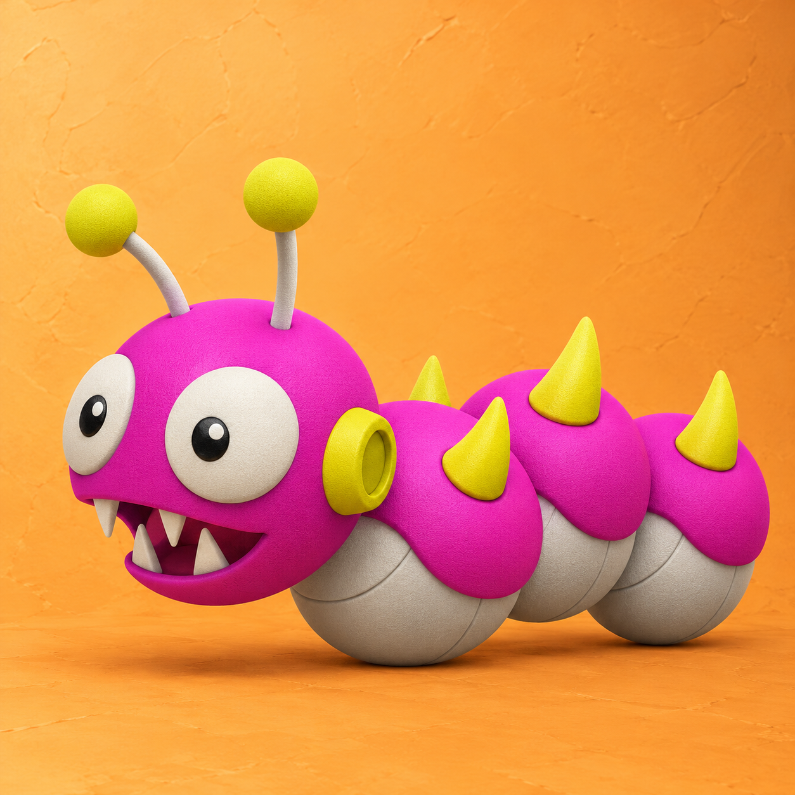

# Caterkiller

<p align="center">
  
</p>

A tiny Pump.fun-style CLI trading bot for local experimentation.

This is a prototype: simulation-first, mostly untested in live markets, and meant to be used carefully.

(In simulation mode, you still pay for the PumpPortal Event API.)

See also

[Program jargon.txt](./jargon.txt)

## Quick start

```bash
npm install
node caterkiller.js
```

Windows:

```bat
start.bat
```

## Config

Copy `.env.example` to `.env` and edit it:

```env
PUMP_API_KEY=
PUBLIC_WALLET_KEY=
MINT=11111111111111111111111111111111111111111111
STRATEGY=dca
MODE=sim
DCA_INTERVAL_MS=60000
DCA_AMOUNT_SOL=0.01
```

## Commands

```text
help
pos
wallet
mcap
strategy
strategy dca
start
stop
buyamt 0.01
buy 0.01
sell 100
exit
```

## Layout

```text
caterkiller.js        entry point
js/app.js             startup and process hooks
js/config.js          constants, endpoints, strategy table
js/state.js           shared mutable state
js/math.js            pure numeric helpers
js/format.js          display formatting
js/log.js             colored console output
js/env.js             .env read and write
js/settings.js        state from .env
js/api/               PumpPortal, Pump.fun, Solana RPC, and websocket clients
js/trading/           price extraction, history, positions, signals, execution
js/ui/                status, help, banner, and prompt rendering
js/cli/               command table and REPL loop
```

## Notes

- `STRATEGY` can be `dca`, `momentum`, `meanReversion`, or `breakout`
- `MODE` is `sim` or `live`
- Live trading is experimental and depends on the current PumpPortal feed
- Trade prices come from PumpPortal trade events for the current mint: the bonding-curve reserves for pump.fun trades, and the trade amounts for other pools
- This project is not a production trading system
